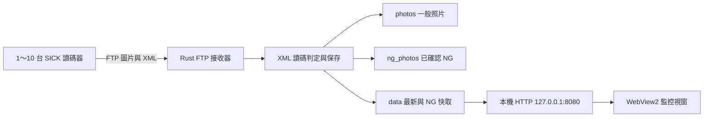

# SICK 轉接平台讀碼影像監控

**[開啟互動展示版](https://wkltueserc20.github.io/SICK-GLS611lector-monitor/)** · 不需安裝或連接設備，可體驗一台／四台／十台、OK／NG 模擬、照片放大與設備設定。所有圖片及條碼均為假資料，設定僅影響訪客自己的瀏覽器。[展示版說明](demo/README.md)

集中監看 1～10 台讀碼器（預設四台）的最新照片、最近 NG 照片與條碼文字。以 Rust 接收 FTP 圖片與 XML，使用網頁介面嵌入 Windows 視窗。部署不需要 Python 或 Node.js。

**下載：[Releases 免安裝部署包](https://github.com/wkltueserc20/SICK-GLS611lector-monitor/releases/latest)**。請下載版本 ZIP，解壓後執行 EXE。這是免安裝部署包，不會自動修改相機或防火牆。

## 使用設備

本專案現場使用的是 **SICK Lector611 Liquid Lens 工業影像式讀碼器**，透過 SOPAS ET 設定。儲存庫名稱中的 GLS611 不作為設備型號依據，請以實際銘牌為準；其他型號與韌體仍需確認 FTP／XML 格式相容性。

| 位置 | 預設設備 IP |
| --- | --- |
| 左上 | 192.168.12.17 |
| 右上 | 192.168.12.18 |
| 左下 | 192.168.12.19 |
| 右下 | 192.168.12.20 |

## 系統架構



相機是 FTP 用戶端，電腦是 FTP 伺服器。顯示的是每次讀碼傳回的照片，並非連續即時串流。條碼文字從 XML 取得，程式不會重新辨識照片。

| 原始碼 | 職責 |
| --- | --- |
| `src/main.rs` | 啟動、設定、本機 HTTP 與視窗生命週期 |
| `src/ftp.rs` | FTP 登入、來源 IP 限制、主動／被動傳輸及接收 |
| `src/storage.rs` | XML 判定、NG 歸檔、快取、狀態與保留上限 |
| `assets/` | HTML、CSS、JavaScript、LOGO 與圖示 |
| `build.rs` | Windows 圖示資源嵌入 |
| `tests/system_test.py` | 四來源 FTP 與保存功能的模擬整合測試 |

## 相機與電腦的連線設定

1. 電腦使用可與設備互通的固定 IPv4，將部署包解壓至可寫入的資料夾，例如 `D:\轉接平台照片`。沒有 D 槽可使用其他位置。
2. 開啟 EXE；首次啟動會建立預設設定及資料目錄。視窗需要 [Microsoft Edge WebView2 Runtime](https://developer.microsoft.com/en-us/microsoft-edge/webview2/)。
3. 由管理人員允許下表 FTP 入站連線。部署包提供 `允許設備傳入照片.cmd`，需以系統管理員身分執行，依目前 config.json 的啟用設備及 FTP 埠建立規則；沒有設定檔時使用 config.example.json。
4. 在 SOPAS ET 的影像儲存設定，啟用 FTP 目的地，填入**監控電腦 IP**、埠 `2121`、協定 FTP、帳號與密碼均為 `anonymous`。
5. 首要圖片儲存條件選 `Always`，啟用照片與對應 XML 結果輸出，並依 SOPAS 操作保存到設備。選項名稱依韌體版本可能不同。
6. 逐台觸發，確認四個位置的照片時間、條碼文字及 NoRead／NG 結果。

| TCP 埠 | 用途 |
| --- | --- |
| 2121 | 電腦 FTP 控制連線 |
| 30000–30010 | FTP 被動模式資料連線；防火牆需一併開放 |
| 8080 | 本機 HTTP，僅綁定 127.0.0.1，不提供區網遠端觀看 |
| 設備 2112 | 設備通訊埠，與接收照片的 2121 不同 |

## 操作與判定規則

- 開啟 EXE 或桌面捷徑即開始接收，不顯示黑色終端機。最小化仍接收；關閉視窗會停止本程式的 FTP 與 HTTP。
- 暫停只凍結顯示，背景仍保存照片，可用空白鍵切換。可以依位置篩選、切換最新／NG、放大、旋轉及複製條碼文字。
- 最近 NG 是最後一張已確認 NG，最新照片恢復 OK 後仍保留供追查，請同時查看時間。
- 有效條碼結果視為 OK；NoRead 或已進行解碼但無有效條碼的結果視為 NG。XML 缺少、損壞或資訊不足時顯示等待判定／待確認，不直接視為 OK。
- 這是圖片的解碼結果，不等於 PLC 最終產品判定，也不包含條碼內容比對與品質等級驗證。
- 啟動時掃描既有圖片及 XML，將可確認的 NG 移入 `ng_photos` 並重建快取；缺少足夠 XML 的舊圖片無法可靠補判。

## 保留規則與部署注意事項

每個設備固定識別碼下的 `photos` 與 `ng_photos` **合計最多保留 1000 張**，超過後刪除最舊圖片及配對 XML；`data` 的最新／NG 固定快取另計。不是永久備份，調低上限前請備份。四台各 1000 張、每張約 250 KB，圖片約 1 GB，建議預留至少 1.5–2 GB。

更換 IP、名稱或 FTP 埠，請從「設備設定」修改，儲存後關閉並重新開啟程式。來源 IP 不可重複，畫面依清單順序排列。這不會修改設備本身 IP；SOPAS 與防火牆來源限制也要同步調整。更換監控電腦則需修改各台設備的 FTP 目的地。

FTP 未加密，請使用受控設備網路，不要將接收埠公開到網際網路。未簽章的 EXE 可能被 Windows 智慧型應用程式控制或企業政策封鎖；ZIP 不保證解除限制，請由管理人員依組織政策部署。

沒有照片時，依序確認程式仍開啟、設備 FTP 目的地、2121 與被動資料埠、防火牆、設定來源 IP 及 `logs/receiver-rust.log`。有圖片卻沒有條碼／NG 時，確認也有傳送相對應的 XML。啟動失敗則確認舊版未占用連接埠、資料夾可寫入且已安裝 WebView2。

原始碼與文件放在 Git，部署 ZIP、EXE、圖示與校驗碼放在 Releases。現場照片、個人設定及執行紀錄不納入 Git。第三方授權文字隨部署包提供；本專案尚未指定專案授權，公開可見不表示授予任意重用權利。

## 從 Python 版本遷移

1. 關閉 Python 版監控視窗，備份現有 `config.json`、`photos`、`ng_photos`、`data`。
2. 把 `ChingTech-Monitor-Rust.exe` 放進 `D:\轉接平台照片`，雙擊啟動。
3. 程式使用 EXE 所在資料夾儲存資料，可沿用原有 Python 版資料。首次啟動將重新掃描 XML 並整理既有 NG。
4. 四台相機 FTP 目的仍是這台電腦的 IPv4，埠 2121，使用者和密碼 `anonymous`。
5. 防火牆入站允許 TCP 2121、30000–30010，來源限制為四台相機 IP。網頁只綁定 127.0.0.1。
6. 四台各實際觸發一次 OK 和 NoRead，確認對應位置及最近 NG。
7. 關閉應用程式視窗即停止接收；已存照片不刪除。不能與 Python 版同時使用相同連接埠。

未簽章的 EXE 仍可能被 Windows Smart App Control 封鎖。正式部署需受信任的程式碼簽章或 IT 審核；Rust 不會繞過安全政策。

## v2.2.0 設備設定

點選右上角「設備設定」，可新增／移除／排序 1～10 台設備（含停用設備），修改名稱、來源 IP 與各台 FTP 接收埠。取消啟用可保留設定及照片，畫面不顯示也不接收該設備。全部停用時仍能進入設定。

設備可共用預設 FTP 埠 2121，也可指定獨立埠；程式會檢查來源 IP 與接收埠的組合。FTP 埠不可為 0、本機網頁埠或被動資料範圍 30000–30010。被占用的新增埠會拒絕儲存；重開時仍會再次檢查。

設定儲存到 `config.json`，**需關閉並重新開啟程式後套用**，目前接收不中斷。尚未套用會顯示提示；重新開啟設定表單讀取的是已儲存版本，監控卡片則維持正在執行的版本。每次儲存會將前一次設定備份為 `config.previous.json`。

「匯出 JSON」下載目前表單設定（不含照片）；「匯入 JSON」先載入表單，檢查後按儲存才會寫入。可匯入 config.previous.json 還原前一次設定。尚未儲存便關閉表單時，會提示儲存或捨棄修改。

每台都有固定 `id`，新設備由介面自動產生，舊設定首次啟動時以原 IP 補齊並保存。照片位於 `photos/<id>`、`ng_photos/<id>`；舊設備仍沿用原 IP 名稱的資料夾。**更改 IP 或名稱不會變更 id／資料夾，也不會拆開歷史 NG。請勿手動更改 id。** 刪除設備只移除設定，不刪除照片；日後重建新設備會產生新 id，需要沿用歷史時請還原設定備份。

可在介面調整每台照片上限與未接收提醒秒數（預設 300，0 關閉）。「長時間未收到」是照片時間提醒，不等於網路斷線。資料根目錄仍由 EXE 位置或 `--data-dir` 指定，設定視窗可查看路徑。

以下為四台預設範例；只用一台時保留一筆 cameras 即可。舊版省略 id、enabled、設備 ftp_port、stale_seconds 的設定仍可載入。

```json
{
  "ftp_host": "0.0.0.0",
  "ftp_port": 2121,
  "web_port": 8080,
  "max_photos": 1000,
  "stale_seconds": 300,
  "cameras": [
    {
      "id": "192.168.12.17",
      "ip": "192.168.12.17",
      "label": "左上",
      "ftp_port": null,
      "enabled": true
    },
    {
      "id": "192.168.12.18",
      "ip": "192.168.12.18",
      "label": "右上",
      "ftp_port": null,
      "enabled": true
    },
    {
      "id": "192.168.12.19",
      "ip": "192.168.12.19",
      "label": "左下",
      "ftp_port": null,
      "enabled": true
    },
    {
      "id": "192.168.12.20",
      "ip": "192.168.12.20",
      "label": "右下",
      "ftp_port": null,
      "enabled": true
    }
  ]
}
```

單台畫面自動放大，多台依視窗寬度排列，亦可篩選單台檢視。10 台預設各 1000 張、每張 250 KB 時，圖片約 2.5 GB，另需預留 XML、快取與日誌空間。

## 2.1 介面更新

2.1.1：加入相機＋四格監控專屬圖示，EXE、桌面捷徑與視窗均可使用。若舊捷徑仍顯示快取圖示，可在捷徑內容的「變更圖示」選取包內 ChingTech-Monitor.ico，或刪除舊捷徑後由新 EXE 建立。

- 2.1 時固定四個位置排列（2.2 改為動態設備），加入方位圖示、最新 NG 與歷史 NG 分開統計。
- 單一位置檢視，及「最新＋NG／只看最新／只看 NG」切換。
- 條碼內容加大並可複製，接收時間同時顯示距今多久。
- 照片可放大、旋轉；檢查時固定照片像素，不受新照片覆蓋影響。
- 暫停會明確提示背景仍持續接收。空白鍵可暫停／繼續。
- 服務無回應時保留畫面並自動重試，不把舊照片當成連線成功。
- 「說明」可查看實際資料位置與目前保留上限。

從 2.0 更新：先關閉監控視窗，以新版 EXE 取代舊 EXE；保留既有 config.json、photos、ng_photos、data。若桌面捷徑仍指向同一個 EXE 檔名，不需重建捷徑。

## 建置與測試

建置需要 Windows x64、Rust stable（MSVC 工具鏈）、Microsoft C++ Build Tools 與 Windows SDK 的資源編譯器。執行監控視窗需要 Microsoft Edge WebView2 Runtime。

```text
cargo test --locked
cargo build --release --locked
```

`Cargo.lock` 固定相依套件。介面與 LOGO 內嵌在 EXE。`--data-dir <資料夾>` 可指定另一個資料位置。`--headless` 用於接收服務自動測試；`--ui-smoke-test` 會開啟視窗並在四秒後關閉。開發測試請使用獨立資料夾和連接埠。

四路 FTP 整合測試為 `tests/system_test.py`，使用暫存資料與獨立連接埠，不會修改相機設定。先執行 release 建置，再在專案根目錄執行 `python tests/system_test.py`；也可用 `CT_RUST_EXE` 環境變數指定待測 EXE。Python 僅用於開發驗證，部署不需要 Python。

新增 `python tests/device_settings_test.py`，驗證單台／十台、共用及獨立接收埠、來源與埠配對、停用設備、設定驗證、備份、待重啟套用及改 IP 後歷史保留。使用暫存資料與 22221–22224、28081 及被動埠，勿與生產環境同時占用。

`config.example.json` 是設定範本；執行時的 `config.json`、生產照片、NG 照片、紀錄和建置輸出均排除於 Git 之外。

已通過：Rust 單元測試、四個來源 IP 同時與連續 FTP 傳送、主動／被動模式、照片與 XML 先後順序、同名檔案隔離、NG 歸檔與保留上限、16 張既有照片副本與 Python 判定比對、重開後狀態保存，以及原生視窗結束後 FTP／HTTP 端口釋放。
